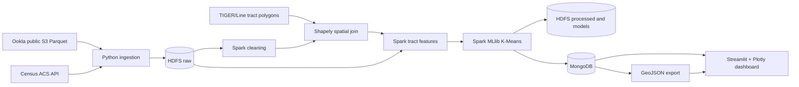

# Detecting Digital Divide Patterns from Internet Accessibility Data

A runnable reference pipeline for a three-tier digital divide atlas. It combines Ookla Speedtest fixed or mobile tile aggregates with U.S. Census ACS tracts, India district boundaries and NFHS-5 survey indicators, and World Bank country indicators. Spark cleans the tiles, assigns them to census tracts, Indian districts, or countries, builds regional features, and fits K-Means segments. Results go to HDFS and MongoDB, with GeoJSON map exports and a Streamlit dashboard.

## Architecture



| Tier | Boundary source | Socioeconomic source | Model features |
| --- | --- | --- | --- |
| United States | TIGER/Line census tracts (IL, WV, GA region-first) | ACS 2022 5-year estimates | download, upload, latency + broadband adoption, median income, bachelor's share |
| India | geoBoundaries ADM2 districts (735) | NFHS-5 state factsheets broadcast to districts | download, upload, latency + internet use, literacy |
| World | Natural Earth 1:110m countries (177) | World Bank API (latest available year) | download, upload, latency + internet users, GDP per capita |

Each region is configured under `regions:` in `config/config.yaml` and shares one MongoDB document schema: `region_id`, `parent_1`, `parent_2`, `region_name`, connectivity metrics, socioeconomic metrics, and cluster fields. All stages accept `--region us|india|world`.

## What the pipeline produces

- Cleaned tile Parquet and region-assigned tile Parquet in HDFS, namespaced by region.
- One feature row per tract, district, or country with test-weighted download/upload/latency, total tests, a sum of Ookla's per-tile device counts, and the configured socioeconomic features.
- Median-imputed feature values for regions observing at least three model features.
- Standardized K-Means labels and saved scaler/model, plus WSSSE and sampled silhouette results per region.
- MongoDB cluster records (`clusters`, `clusters_india`, `clusters_world`), per-region GeoJSON files, and evaluation plots.

Cluster names (`well-served`, `underserved`, `low-income, low-adoption`, and `mixed-access`) are descriptive rules based on cluster averages compared with the overall median. When several clusters share a rule label, the cluster id is appended (for example `low-income, low-adoption (2)`) so each segment stays selectable. They are not causal findings. Ookla's `devices` value is unique within an individual tile; summing it across a tract does not deduplicate a device appearing in multiple tiles.

## Quick start

Prerequisites: Docker with the Compose plugin, Python 3.9+ (3.10 or 3.11 recommended), Java 11 or 17 for local Spark tests, and enough disk space for the selected Ookla quarter plus TIGER/Line polygons. The complete global Ookla quarter can be large. Set `OOKLA_FILE_LIMIT=1` for a one-file smoke run when the quarter has multiple objects.

```bash
cd digital-divide-project
python -m venv .venv
source .venv/bin/activate
pip install -r requirements.txt
docker compose -f docker/docker-compose.yml up -d --build --wait

# Downloads the default 2023 Q2 fixed Ookla data, 2022 ACS estimates and TIGER tract shapes,
# then runs each Spark job and loads the result into MongoDB.
REGION=us scripts/run_pipeline.sh     # Illinois, West Virginia, Georgia tracts
REGION=india scripts/run_pipeline.sh  # 735 districts, NFHS-5 state indicators
REGION=world scripts/run_pipeline.sh  # 177 countries, World Bank indicators

streamlit run src/visualize/dashboard.py
```

Or run the complete workflow with one command. `REGIONS` accepts a space- or comma-separated list and defaults to all three tiers:

```bash
./scripts/run_all.sh
REGIONS=india ./scripts/run_all.sh
REGIONS="us,world" NO_DASHBOARD=1 ./scripts/run_all.sh
SKIP_PIPELINES=1 ./scripts/run_all.sh  # start services and open the dashboard using existing data
```

Set `NO_DASHBOARD=1` to finish after the selected pipelines, or `SKIP_PIPELINES=1` to start the services and open the dashboard without rerunning pipelines.

The pipeline is rerunnable: HDFS stage outputs are overwritten and MongoDB rows are upserted by `region_id`. Change the source quarter with environment variables:

```bash
OOKLA_TYPE=mobile OOKLA_YEAR=2023 OOKLA_QUARTER=2 scripts/run_pipeline.sh
```

To run ingestion separately, use `python -m src.ingest.download_ookla --type fixed --year 2023 --quarter 2 --limit 1` and `python -m src.ingest.download_census`. The S3 client uses unsigned requests; no AWS credentials are needed. Census API calls require a free API key. Set `CENSUS_API_KEY` in the environment or configure `census.api_key` in `config/config.yaml`.

## Services and ports

| Service | Local address | Purpose |
| --- | --- | --- |
| HDFS NameNode UI | `http://localhost:9870` | Browse HDFS |
| HDFS RPC | `localhost:9000` | Host-side Hadoop clients |
| MongoDB | `localhost:27017` | Served cluster documents |
| Spark runtime | Docker service `spark` | Spark 3.5 and Hadoop client for pipeline jobs |

The compose file uses a single HDFS DataNode and single-node local Spark for laptop development. MongoDB's development credentials are `admin` / `secret`; change these before exposing the services beyond localhost. Data persists in named Docker volumes.

## Dashboard and outputs

The dashboard adapts labels, filters, and measures to the selected tier. It includes cluster counts, feature distributions, an interactive map, and top/bottom region tables. Run it after a pipeline; on startup it reads MongoDB at `localhost:27017` and the selected region's GeoJSON. Choose US Tracts, India Districts, or World Countries in the sidebar. `MONGODB_COLLECTION` remains available as the initial selection override:

```bash
MONGODB_COLLECTION=clusters_india streamlit run src/visualize/dashboard.py
MONGODB_COLLECTION=clusters_world streamlit run src/visualize/dashboard.py
```

Useful artifacts:

- HDFS: `/user/digitaldivide/raw`, `/user/digitaldivide/processed` (per-region subfolders), `/user/digitaldivide/models`
- Local: `data/processed/model_metrics*.json`, `data/processed/plots/kmeans_evaluation*.png`, `data/processed/clusters*.geojson`

## Notebooks

The four notebooks in `notebooks/` walk through exploration, Spark processing, clustering/evaluation, and visualization. They assume the project dependencies are installed. The processing and model notebooks also require the Docker services. Regenerate the checked-in notebooks with `python scripts/create_notebooks.py`.

## Tests

The test suite covers Census response parsing, unsigned S3 listing, Spark metric normalization/quality filtering, a sample spatial join, and a synthetic K-Means run. Run it with `pytest` from the project root. Tests use local Spark and do not call Census or S3.

## Scope and data caveats

- Ookla measurements are user-initiated Speedtest aggregates and are not a census of all households or a measure of advertised plan availability.
- A tract with no Ookla tile is absent from the modeled feature set. The resulting map describes observed tiles assigned to tracts, not universal access.
- The workflow uses one selected Ookla quarter. ACS 5-year estimates smooth across five years, NFHS-5 is a 2019-21 survey, and World Bank indicators use each country's latest available year, so the tiers are not synchronized in time.
- NFHS-5 internet-use and literacy values are **state-level** and broadcast to districts. The compiled district factsheet dataset covers only 21 states and lacks the internet indicators, so district-level variation in the India tier comes from Ookla connectivity, not the socioeconomic features.
- The three tiers use different feature sets and different numbers of features. Compare segments within a tier, not across tiers.
- Segment names are rule-based. For India and the world tier, `income_feature` is literacy or GDP per capita respectively, so "low-income" is an approximate label for those tiers.
- A region with no Ookla tile is absent from the modeled feature set. The resulting maps describe observed tiles assigned to regions, not universal access.
- Natural Earth 1:110m boundaries omit some small territories; only countries with at least one assigned tile enter the world feature table.
- K-Means segments are exploratory and sensitive to the selected quarter, feature definitions, imputation, and k range. Review the evaluation plot and cluster distributions before interpretation.
- The Python STRtree is broadcast to Spark workers. It removes the need for a Spark geospatial extension, but the geometry broadcast and Python UDF add CPU and memory costs at full global scale. For sustained production workloads, use a partition-aware geospatial engine such as Apache Sedona.

See [SETUP_GUIDE.md](SETUP_GUIDE.md) for laptop setup and troubleshooting.

## Source references

- [Ookla Open Data schema and S3 paths](https://github.com/teamookla/ookla-open-data)
- [ACS 2022 B28002 broadband variable](https://api.census.gov/data/2022/acs/acs5/variables/B28002_004E.html)
- [Census TIGER/Line tract geography](https://www.census.gov/geographies/mapping-files/time-series/geo/tiger-line-file.html)
- [NFHS-5 compiled state fact sheets](https://github.com/pratapvardhan/NFHS-5) (CC BY 4.0)
- [geoBoundaries India ADM1/ADM2](https://www.geoboundaries.org) (ODbL)
- [Natural Earth admin-0 countries](https://www.naturalearthdata.com) (public domain)
- [World Bank Indicators API](https://datahelpdesk.worldbank.org/knowledgebase/articles/889392)
